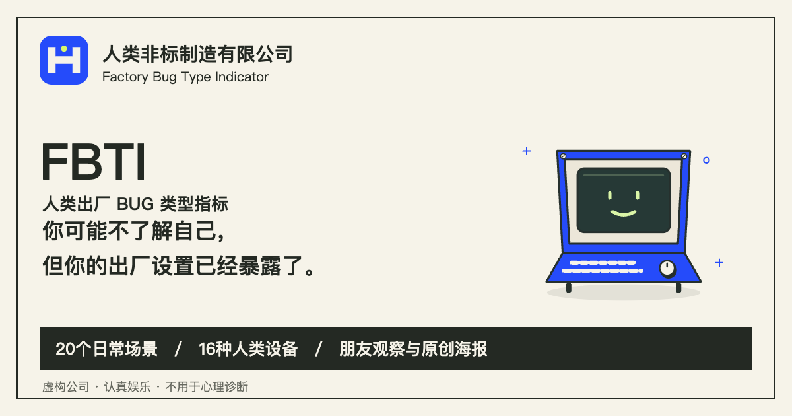
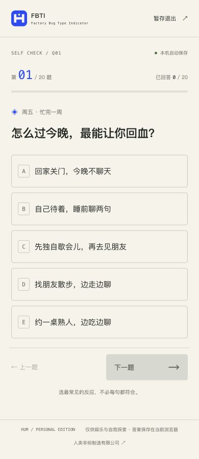
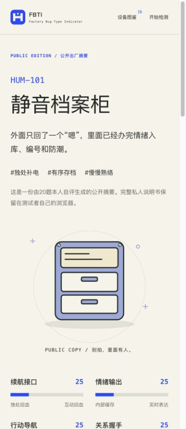
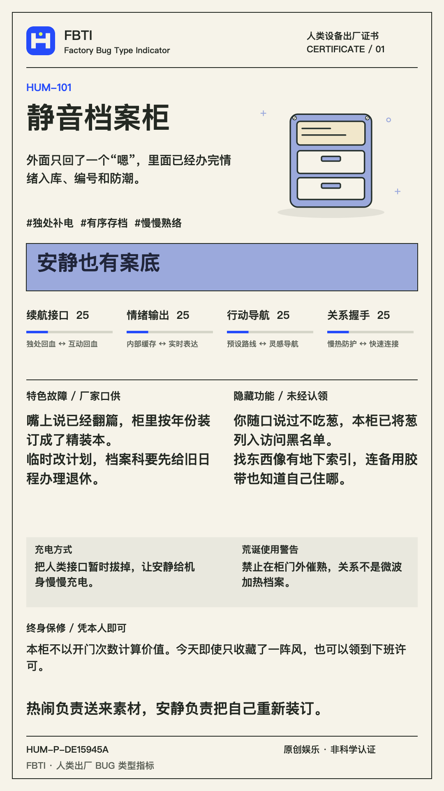

# FBTI

Factory Bug Type Indicator

[简体中文](README.md) · [Try it online](https://immortal-zhang.github.io/fbti/)



**An absurdly earnest owner's manual for your human hardware.**

20 everyday scenarios → 16 device personalities → your own manual. Invite a friend for a second opinion.

<table>
  <tr>
    <th>Quiz</th>
    <th>Profile</th>
    <th>Poster</th>
  </tr>
  <tr>
    <td width="33%"></td>
    <td width="33%"></td>
    <td width="33%"></td>
  </tr>
</table>

**13-chapter manual · PNG export · 8-question friend check · Local storage**

## Run locally

Node.js 24 · Next.js · React · TypeScript

```sh
git clone https://github.com/Immortal-Zhang/fbti.git
cd fbti
npm ci
npm run dev -- --port 3127
```

Open [127.0.0.1:3127](http://127.0.0.1:3127). `npm run check` runs lint, type checking, 486 tests and the production build.

Chinese UI. No account, database or AI API required. For entertainment, not psychological diagnosis.

[Scoring (Chinese)](docs/SCORING.md) · [Deployment](docs/DEPLOYMENT.md)

Open the online link to take the test—no installation needed.
